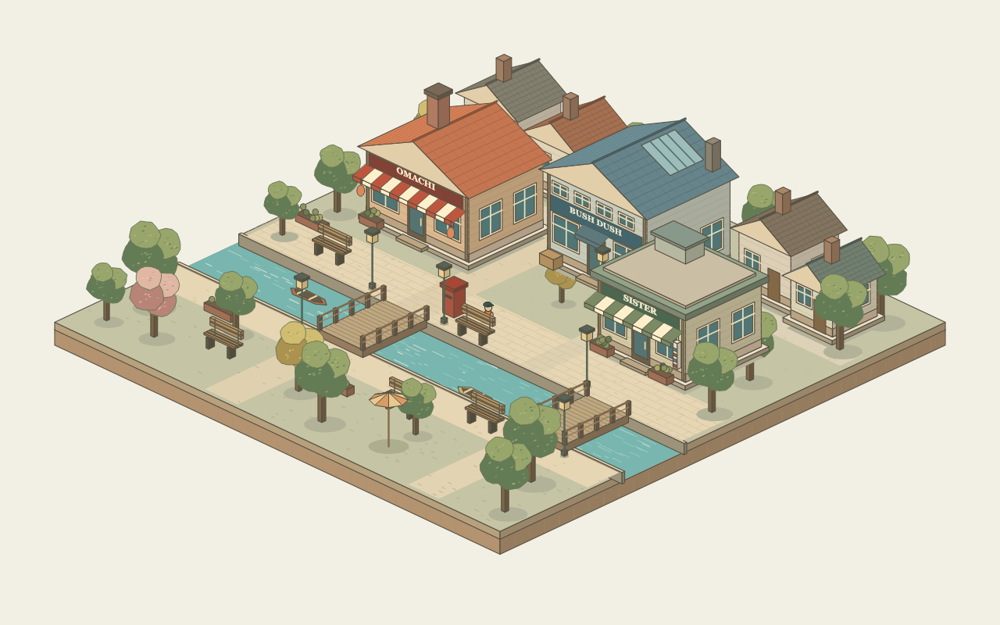

# 川辺の制作街

澤井航志の制作を、川辺の街を歩きながら巡るポートフォリオ。April Zhu の [Pocket City](https://april-zhu.com/pocketcity) を参考にした架空の街区です。地形・建物・室内はこのプロジェクト用の Canvas 描画です。

**開発中**　街と3棟の室内を描画できる段階です。次は、広場から食堂まで歩き、扉を開けて展示を操作する機能を実装します。

| 街の建物 | 展示する作品 |
| --- | --- |
| まちの食堂 | おまちどう（飲食店の待ち時間予測） |
| ゲーム工房 | BushDush V2（Unityの皿選択判定） |
| 川辺の理容室 | SISTER（理美容店サイトの試作画面） |

## T3 Code から再開する

T3 Code でこの README がある `koshi-town` フォルダーをプロジェクトとして開き、Codex のスレッドに次の指示を貼り付けます。

> $walkable-portfolio を使い、現在のファイルを確認して「最初の実装」を進めてください。既存の街・室内の描画と作品データを使い、PCとスマートフォンで「歩く → 入る → 作品を見る → 同じ入口へ戻る」を3棟とも実操作で確認してください。完成時に起動方法と確認できた操作を教えてください。

## 中断時点

| ファイル | 内容 |
| --- | --- |
| `dist/index.html` | 街、案内所、作品一覧、プロフィールに使うHTMLの骨格 |
| `dist/projects.js` | 3作品の紹介・建物・敷地・ドア、川と橋、スタート位置 |
| `dist/scene.js` | 地形と街の建物、歩行者、作品別の室内と家具を描くCanvas関数 |
| `dist/assets/sister-*.webp` | SISTERの試作サイトから書き出した、店の入口と店内の実画面 |
| `.agents/skills/walkable-portfolio/` | このプロジェクトで使うCodexスキル |

この時点では HTML が参照する `dist/app.js` と `dist/style.css` が未作成です。HTMLを開いてもまだ歩けません。

## 最初の実装

1. **まず街を表示する。** Canvasの表示領域と端末のピクセル比を測り、`Pen` で `ground` を描いてから `townObjects()` の各要素の `draw(pen)` を深度順に実行する。`avatar` を同じ順序に挿入する。室内では同様に `roomGround` と `roomObjects(project)` を使う。拡大・リサイズ後もタップ地点を正しく逆投影する。
2. **屋外・室内・展示をつなぐ。** 矢印キー・WASDとタップでの移動、建物・水面の通行判定、橋、入口の操作、退出を実装する。案内所には3作品の直行ボタンを表示する。入退室で見出し、操作案内、フォーカスを更新する。
3. **作品を触れる展示にする。** 食堂は架空の受付・案内時刻で待ち時間を計算する小展示。工房はUnityの `DishDetector.cs` をもとに半径2以内の最寄りの皿を選ぶ平面デモ。理容室は同梱した実画面2枚の切り替え。説明用デモと実際の作品素材に、それぞれの由来を表示する。
4. **小さい画面とキーボードで確認する。** 375px幅では入口と作品一覧を片手で選べるようにする。PC幅では地図を主役にし、案内所を併置する。日本語の見出し、操作、フォーカスを読みやすく保つ。

検証時はプロジェクトのルートから `python -m http.server 8000 --bind 127.0.0.1 --directory dist` を実行し、ブラウザで http://127.0.0.1:8000/ を開きます。現時点のデータと描画には外部ライブラリやビルド工程はありません。

